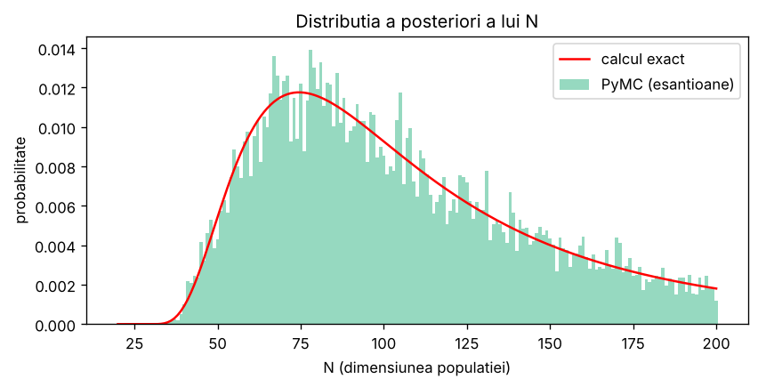
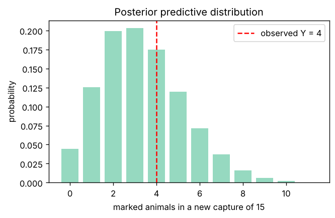

# Exercise 1: Estimating the size of a population

Code: the "Exercise 1" section of `Tema7_PMP.ipynb`.

Sampling: 4 chains with 5000 draws each, after 1000 tuning steps, so 20 000 samples of N in total. N is discrete, so PyMC uses Metropolis for it instead of NUTS (it picks this on its own). r_hat is 1.00.

## Model

The prior is N ~ DiscreteUniform(20, 200). For the second capture, Y | N ~ Hypergeometric(N, M = 20, n = 15), with Y = 4 observed.

## a) Posterior of N

The bars are the PyMC samples. The red line is the posterior computed exactly: N can only take 181 values, so I evaluated the hypergeometric probability of seeing 4 marked animals for each N and normalized. The two agree, so the sampler did its job.

Anything below 31 has zero probability. We caught 11 unmarked animals, so there must be at least 20 + 11 = 31 animals in total. The peak is around 75 and the distribution has a long right tail that only stops because the prior ends at 200.

## b) Mean, median and 95% HDI

| | value |
|---|---|
| posterior mean | 103.0 |
| posterior median | 96 |
| 95% HDI | [41, 177] |
| classical estimate M·n/Y | 75 |

The classical estimate is the peak of the posterior. With a uniform prior the most likely value of N is the same as the maximum likelihood estimate, so that's expected. The posterior mean is higher (103) because of the long right tail: with only 4 marked animals in the second capture, populations of 120 or 150 are still fairly plausible, and they pull the mean up. The mean also depends on where the prior is cut off (200), while the peak doesn't.

## c) P(N > 100 | Y = 4)

About 0.45, computed as the share of samples with N > 100. So it's close to a coin flip whether the population is above 100, which shows how little information 4 recaptured animals really give.

## d) Posterior predictive for a new capture of 15 animals

For every sampled N, `pm.sample_posterior_predictive` simulates a new capture of 15 animals (with the same 20 marked ones) and counts how many are marked. The most likely results are 2, 3 or 4 marked animals, each around 20%. Getting 0 happens about 4% of the time and more than 8 almost never.

This is not the same thing as the posterior of N. The posterior of N describes one fixed unknown number, the size of the population. The predictive distribution describes data we haven't seen yet. It includes the uncertainty about N, plus the randomness of which animals get caught, so even if we knew N exactly the number of marked animals would still change from one capture to the next.
