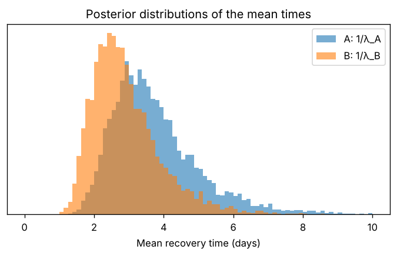
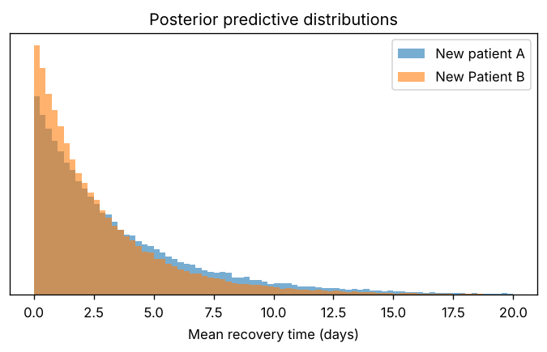

# Exercise 2: Comparing two treatments

Code: the "Exercise 2" section of `Tema7_PMP.ipynb`.

Sampling: 4 chains with 2000 draws each, after 1000 tuning steps, so 8000 samples. PyMC uses NUTS here. r_hat is 1.00 for both rates.

## Model

Priors λ_A, λ_B ~ Gamma(2, 4) (shape 2, rate 4), independent. Recovery times are Exponential(λ_A) for treatment A and Exponential(λ_B) for B. The mean recovery times 1/λ_A and 1/λ_B are computed afterwards, directly from the posterior samples of the rates.

## a) Posterior of the rates

| | mean | 95% HDI |
|---|---|---|
| λ_A | 0.29 | [0.13, 0.48] |
| λ_B | 0.38 | [0.16, 0.61] |

These can also be checked by hand, since the Gamma prior is conjugate to the exponential: λ | data ~ Gamma(2 + n, 4 + sum of times). That gives Gamma(10, 34.2) for A and Gamma(10, 26.3) for B, with mean recovery times 34.2/9 = 3.80 and 26.3/9 = 2.92 days, basically what PyMC gives below.

## b) Mean recovery times 1/λ_A and 1/λ_B

| | mean time | 95% HDI |
|---|---|---|
| treatment A | 3.78 days | [1.72, 6.40] |
| treatment B | 2.93 days | [1.33, 4.95] |

B looks faster, but the two intervals overlap a lot. With 8 patients per group there just isn't much information.

## c) P(mean time of B < mean time of A)

About 0.71, the share of samples where 1/λ_B is smaller than 1/λ_A. That's fairly convincing evidence that B is faster on average, but not conclusive.

## d) Will a new B patient recover faster than a new A patient?

`pm.sample_posterior_predictive` uses the sampled rates to generate recovery times for new patients in both groups. Comparing them pair by pair gives P(new B patient recovers faster than new A patient) ≈ 0.56.

The drop from 0.71 to 0.56 makes sense. In c) we compare averages, and the only uncertainty is about the rates themselves. In d) we compare two specific people, and individual recovery times from an exponential distribution are very spread out: one patient can recover in a day, another can take ten. That noise hides most of the difference between the treatments, so the probability ends up close to 0.5. B is probably better on average, but that tells us much less about any single patient.
