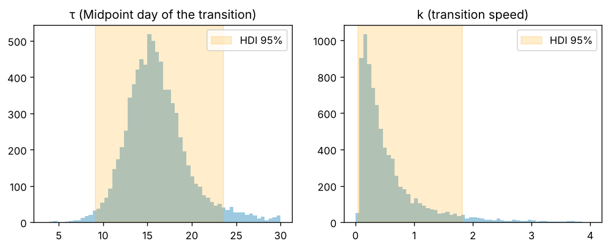
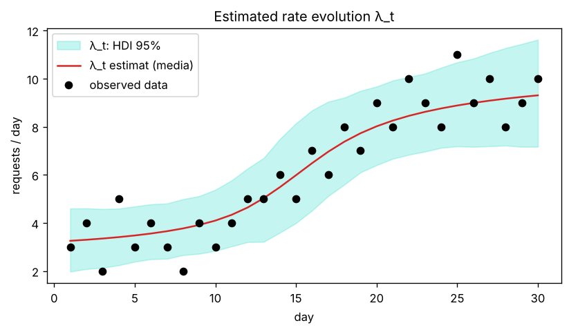
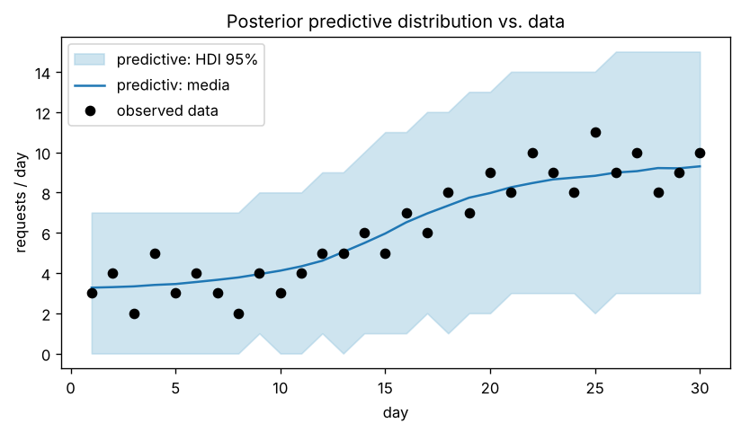

# Exercise 3: Detecting a gradual change in the event rate

Code: the "Exercise 3" section of `Tema7_PMP.ipynb`.

Sampling: 4 chains with 2000 draws each, after 2000 tuning steps, so 8000 samples, with NUTS and target_accept = 0.95. With the default target_accept I got a few divergences (7), and with 0.95 there were none. r_hat is 1.00 for all four parameters.

## Model

Y_t ~ Poisson(λ_t) for t = 1, ..., 30, where λ_t = λ1 + (λ2 − λ1) / (1 + exp(−k(t − τ))). The formula is written directly in the model with `pm.math.exp`. Priors: λ1, λ2 ~ Exponential(0.2), τ ~ Uniform(1, 30), k ~ Exponential(1).

## a) Posterior summary

| | mean | 95% HDI |
|---|---|---|
| λ1 (rate at the start) | 2.88 requests/day | [0.50, 4.64] |
| λ2 (rate at the end) | 9.90 requests/day | [6.87, 14.47] |
| τ (middle of the transition) | day 16.03 | [8.90, 24.39] |
| k (speed of the transition) | 0.58 | [0.05, 1.86] |

## b) τ and k

τ is the day when the rate is exactly halfway between λ1 and λ2, so it marks the middle of the transition. The posterior puts it around day 16, with the 95% HDI going from about day 9 to day 24.

k controls how steep the change is. A large k would mean the rate jumps from λ1 to λ2 within a day or two, a small k means a slow ramp. Most of the posterior is below 1 (mean 0.58), so the data point to a gradual increase spread over a week or more, not a sudden switch. The HDI for k is wide, though. Thirty noisy daily counts aren't enough to pin down the exact speed.

## c) P(λ2 > λ1 | data) and the estimated λ_t

P(λ2 > λ1 | data) ≈ 1.00. In practically all of the 8000 samples the final rate is higher than the initial one.

The red line is the posterior mean of λ_t and the shaded band is its 95% HDI, both computed from the samples for each day. The rate stays around 3 per day for roughly the first ten days, climbs between about day 10 and day 22, and then levels off near 9 per day. It follows the data well.

## d) Posterior predictive check

`pm.sample_posterior_predictive` generates 8000 simulated 30-day series from the fitted model. All 30 observed counts fall inside the 95% predictive interval for their day, and the predictive mean rises slowly the same way the data do, so the model reproduces the gradual transition well. The predictive band is wider than the λ_t band from c) because it also includes the day-to-day Poisson noise, not only the uncertainty about the parameters.
